# Penligent User Guide

## Quick Links

- Website: [https://penligent.ai](https://penligent.ai)
- Community and contact (Discord): [https://discord.gg/3vxXqvQUX7](https://discord.gg/3vxXqvQUX7)

## Quick Start

### Install

Kali Linux is recommended. Download the version that matches your operating system and processor architecture:

- **Windows (x64 only):** Download the Windows installer and double-click the `.exe` file. If a Windows security prompt appears, verify the source and choose to continue running it.
- **macOS (ARM only):** Download and open the `.dmg` file, drag Penligent into the Applications folder, then launch it from Applications.
- **Linux (ARM and AMD):** Download the AMD64 or ARM64 `.deb` package for your device, then run:

  ```bash
  sudo dpkg -i penligent.xxx.xxx.deb
  ```

### Configure the Python Environment

On first use, configure the Python environment Penligent uses to run tools.

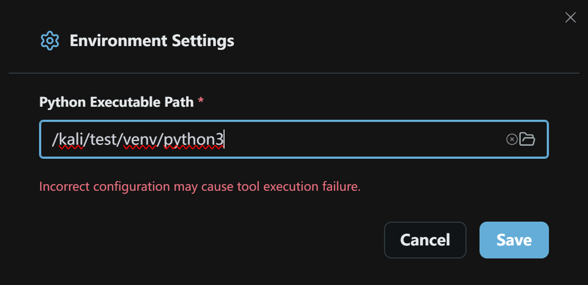

1. Enter the full path to the Python executable in **Python Executable Path**, or click the folder icon to browse for it.
2. Make sure the path points to the intended Python environment. An incorrect path may cause tool execution to fail.
3. Click **Save** to apply the setting, or **Cancel** to discard your changes.

### Create a Penetration Testing Project

Create a project and specify an authorized target before starting a test.

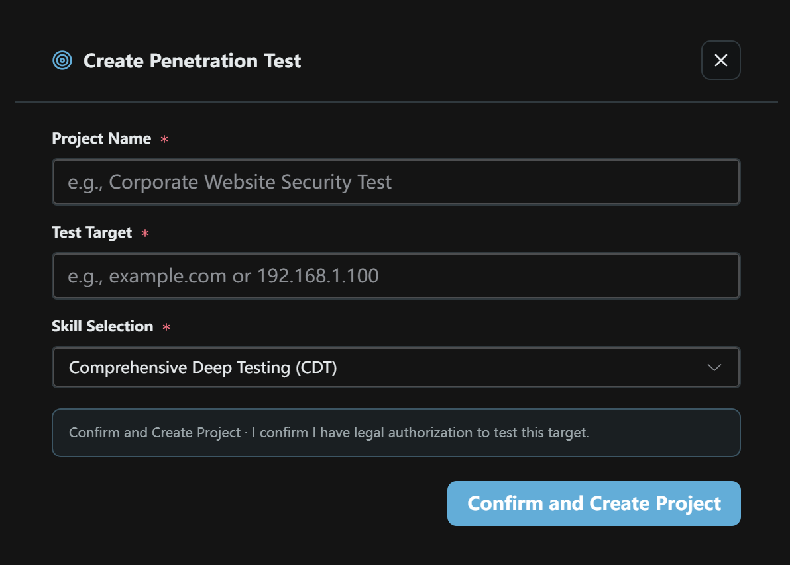

1. Click **New Project** in the top bar or project sidebar.
2. Enter a project name in **Project Name**.
3. Enter an authorized domain, hostname, or IP address in **Test Target**.
4. Choose a testing plan from the **Skill Selection** menu. The screenshot shows **Comprehensive Deep Testing (CDT)** as the default.
5. Confirm that you have legal authorization to test the target.
6. Click **Confirm and Create Project**. The project will appear in the project list.

#### Project Creation Fields

| Field / Control | Required | Description | Example / Notes |
| --- | --- | --- | --- |
| Project Name | Yes | The project name used to identify and manage the penetration testing project. | `Corporate Website Security Test` |
| Test Target | Yes | The target for this test. Enter a domain name, hostname, or IP address. | `example.com` or `192.168.1.100` |
| Skill Selection | Yes | Select the skill or testing plan to use for this test. | Defaults to `Comprehensive Deep Testing (CDT)`; use the drop-down menu to change it. |
| Confirm and Create Project | Confirmation and button | Confirm that you are authorized to test the target, then click the button to create the project. | Do not test targets without authorization. |

### Interact with a Task Using the Agent Console

Use the Agent Console to send questions, context, and follow-up instructions to agents, and to review their responses and task updates.

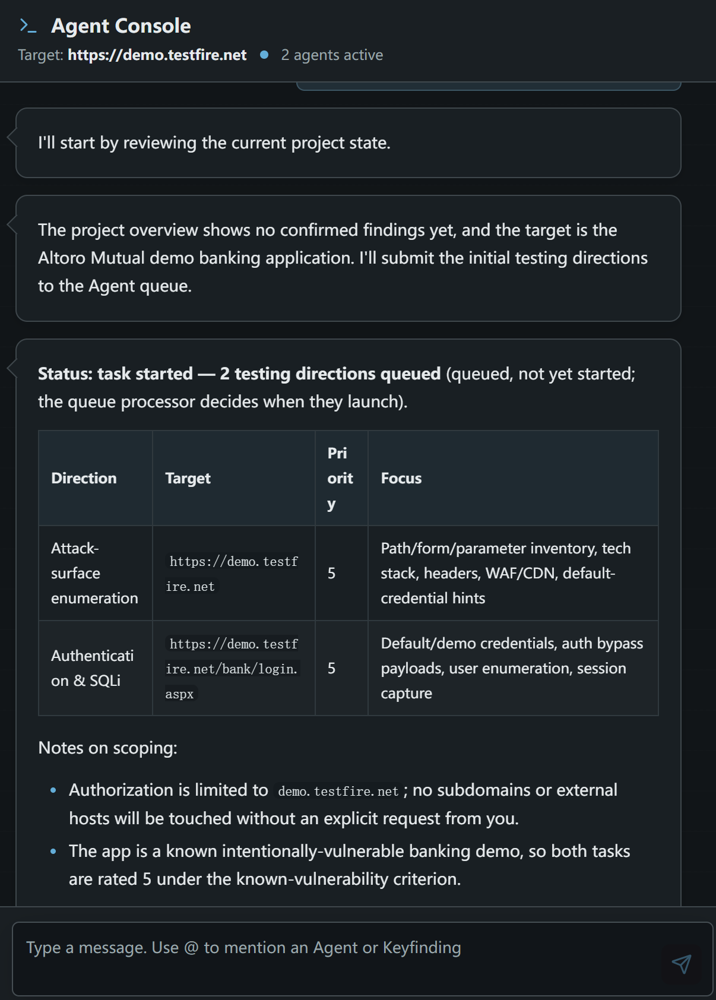

- Review task statuses, queued testing directions, and information returned by agents in the conversation.
- Enter a question, business context, or additional instruction in the message box, then send it.
- Type `@` to mention a specific Agent or Keyfinding.
- Keep any scope updates within the authorized targets. A queued status in the Agent Console does not necessarily mean the task has started.

## Feature Guide

The project navigation bar provides views for the project overview, agent work status, target overview, attack path management, key findings, and tool results. Use **Export Report** on a project page to export a report for that project.

### Global Overview

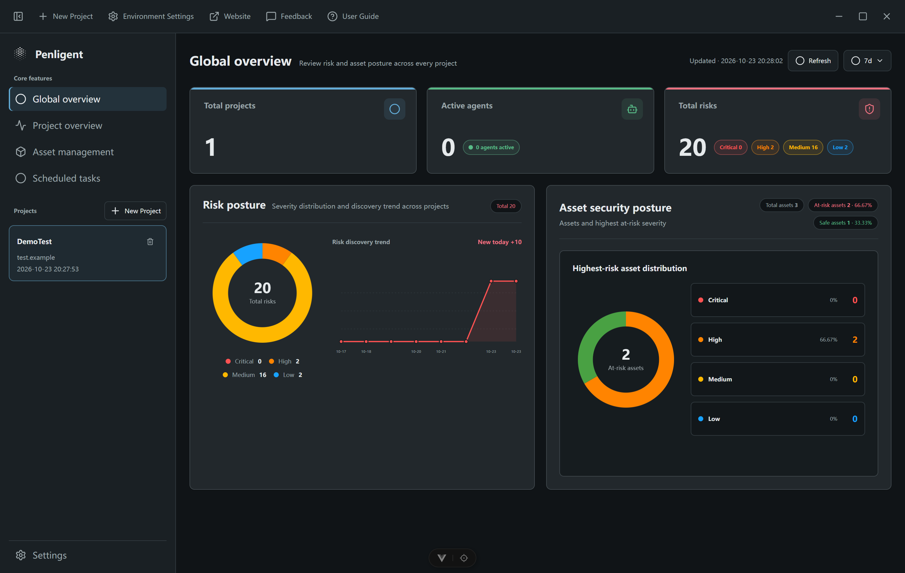

Use the global overview to review risk and asset status across projects:

- **Total projects:** The number of projects currently tracked.
- **Active agents:** The number of agents currently active.
- **Total risks:** The total number of risks and their severity distribution, including Critical, High, Medium, and Low.
- **Risk posture:** Risk severity distribution and discovery trend for the selected period.
- **Asset security posture:** Total assets, at-risk assets, and their highest risk severity.
- Use the time-range menu to change the reporting period, then click **Refresh** to update the data.
- Select a project in the left sidebar to open its overview.

### Project Overview

#### Project Summary

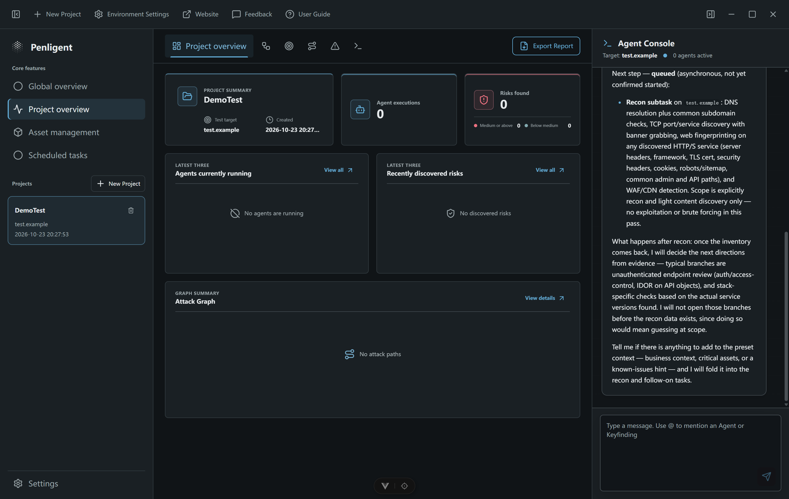

Select a project from the **Projects** list to review its current testing activity:

- The project summary shows the project name, test target, and creation time.
- **Agent executions** shows agent activity; **Risks found** shows discovered risks by severity.
- **Agents currently running** and **Recently discovered risks** show the latest agents and findings. Click **View all** to open the corresponding list.
- **Attack Graph** summarizes discovered attack paths. Click **View details** to see more; an empty state is shown when no paths have been found.
- Click **Export Report** to export a report for the project.

### Agent Work Status

#### View the Task Queue

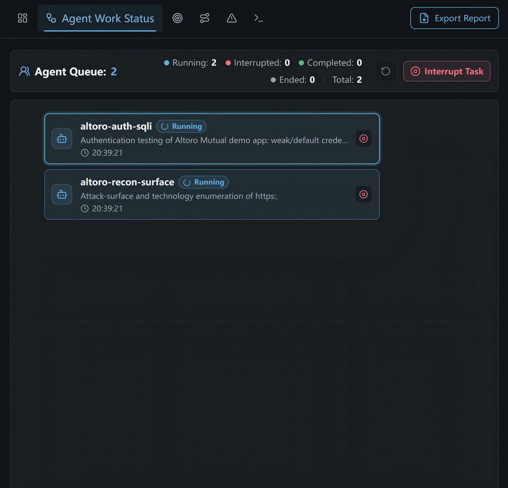

- The queue summary shows task counts for **Running**, **Interrupted**, **Completed**, **Ended**, and **Total**.
- Each task entry shows the agent name, status, task description, and elapsed time.
- Select a task entry to expand its details.
- Use the stop control beside an individual task to stop it, or click **Interrupt Task** to interrupt the current run.
- Click the refresh control near the queue summary to reload the status.

#### Review Task Findings and Action Trail

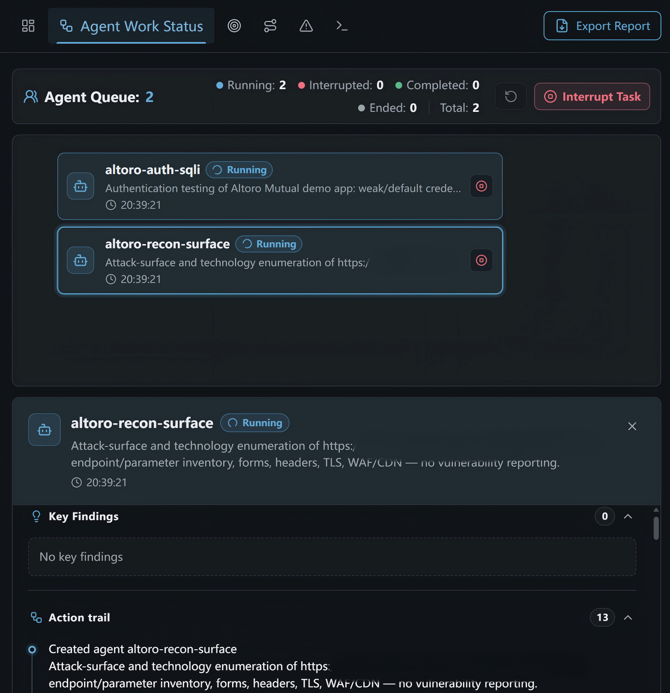

When a task is expanded, you can review:

- **Key Findings:** Findings associated with the task and their count. `No key findings` or a count of `0` means none have been recorded yet.
- **Action trail:** Actions recorded while the task was created and executed. Use the control beside the section title to expand or collapse it.
- The task details area may contain additional execution information; scroll within the area to review it.

### Target Overview

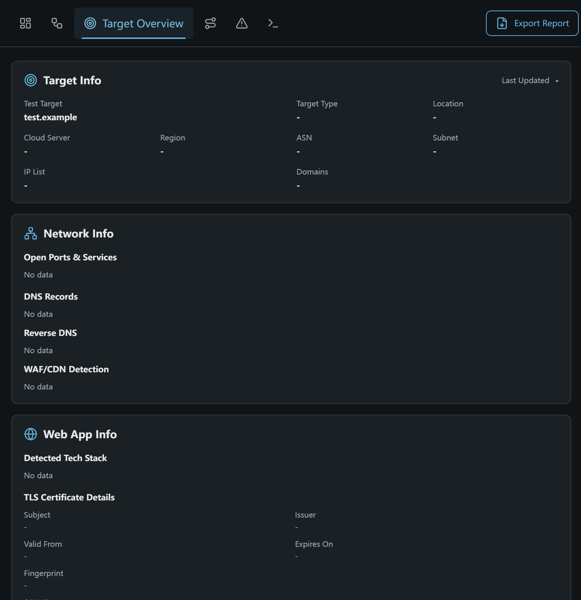

The target overview displays information collected about the test target:

- **Target Info:** Test target, target type, location, cloud provider, region, ASN, subnet, IP addresses, and domains.
- **Network Info:** Open ports and services, DNS records, reverse DNS, and WAF/CDN detection results.
- **Web App Info:** Detected technology stack and TLS certificate details, such as subject, issuer, validity period, and fingerprint.
- A value of `-` or `No data` means that information is not currently available. Discovery results may appear after the task runs.
- Click **Export Report** in the upper-right corner to export the project report.

### Attack Path Management

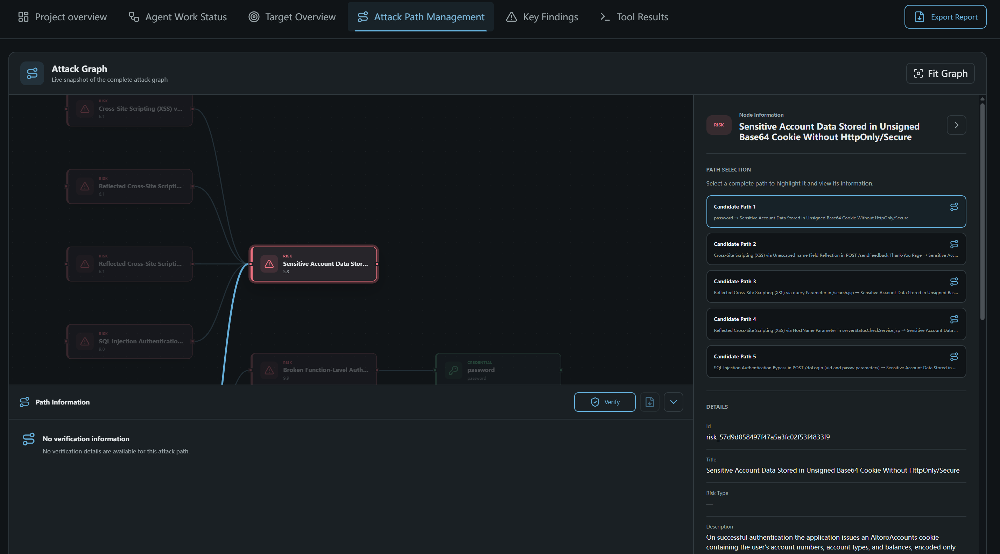

Attack Path Management visualizes relationships between risk nodes and provides candidate path review and verification:

1. Review risk, credential, and other nodes and their relationships in the **Attack Graph** on the left. Click a node to view paths associated with it.
2. Select a candidate path from the **Path Selection** list on the right. The graph highlights the selected path, and the right panel displays the corresponding node information and path details.
3. Review verification information for the selected path in the **Path Information** area below. If the path has not been verified or no results are available, a message indicates that no verification information is available.
4. Click **Verify** to start verification of the selected path. The verification process and results appear in the **Path Information** area.
5. Click **Fit Graph** to fit the graph to the available viewing area.

### Key Findings

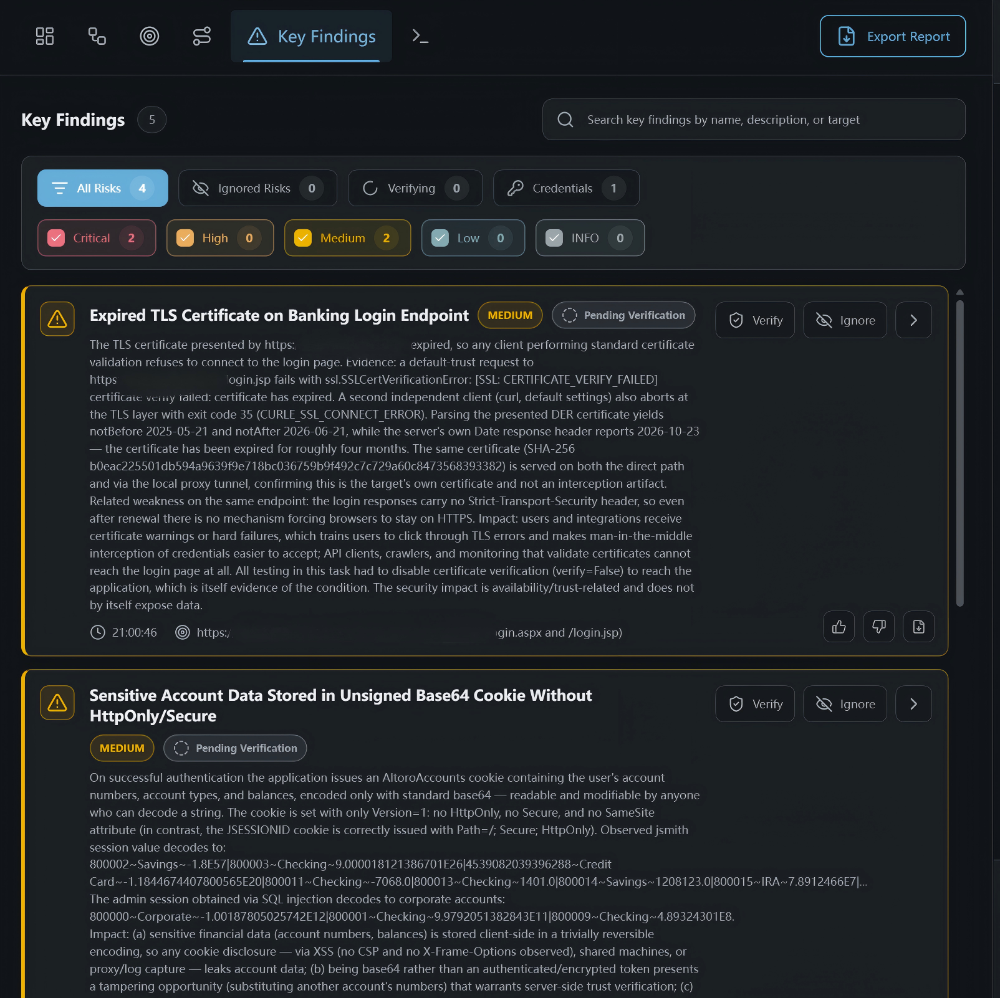

Use Key Findings to filter, inspect, and manage risks identified in the project:

- Search by finding name, description, or target.
- Use **All Risks**, **Ignored Risks**, **Verifying**, or **Credentials** to filter by status or category.
- Use **Critical**, **High**, **Medium**, **Low**, and **INFO** to filter by severity. The numbers beside the filters show the matching counts.
- Review each risk's title, severity, verification status, description, and affected target.
- Click **Verify** to mark a risk for verification, or **Ignore** to move it to the ignored risks list.
- Expand a risk card to view its details.

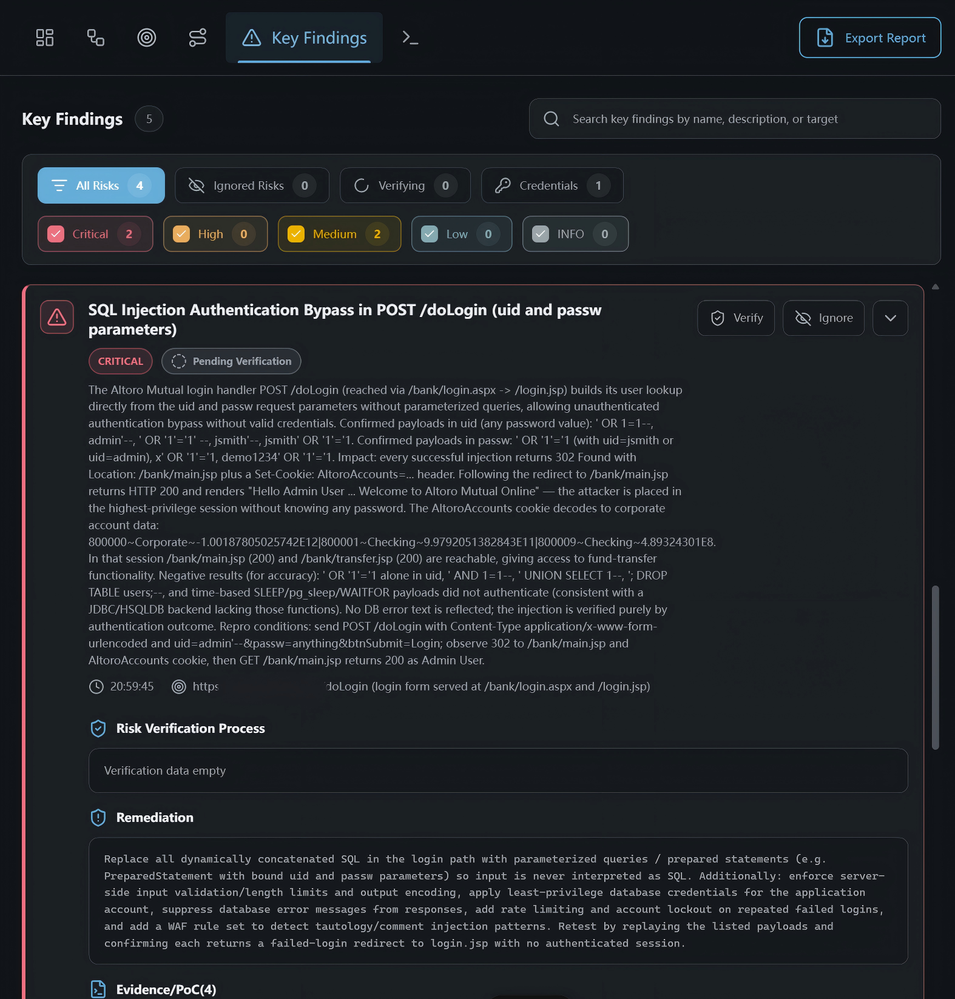

An expanded risk may include the description, verification details, remediation guidance, and evidence:

- **Risk Verification Process:** Review the verification process or data, when available.
- **Remediation:** Review the suggested remediation steps.
- **Evidence/PoC:** Review evidence or proof-of-concept material supporting the finding, when available.
- Available actions depend on the risk's current status. Use **Verify** or **Ignore** to update its handling status.

#### Export a Single Risk Report

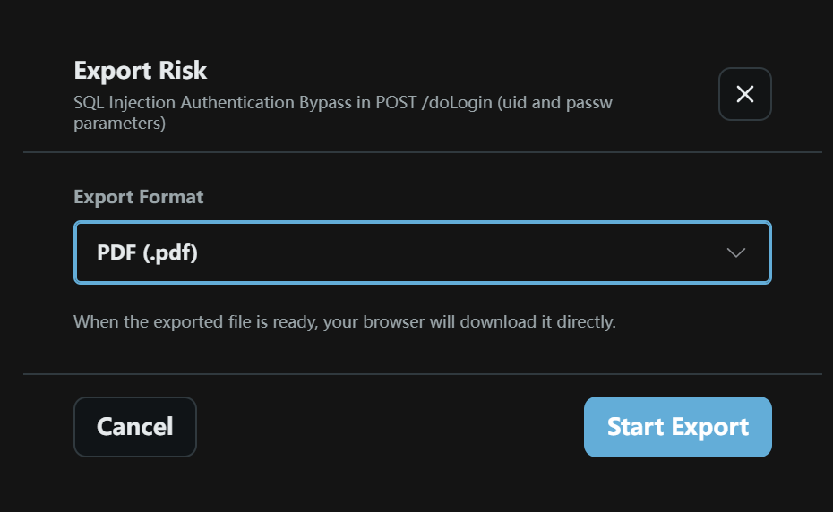

1. Click the export control in the risk details to open the **Export Risk** dialog.
2. Select an available format from **Export Format**, such as **PDF (.pdf)** shown in the screenshot.
3. Click **Start Export**. The browser downloads the file when it is ready.
4. Click **Cancel** to cancel the export.

### Tool Results

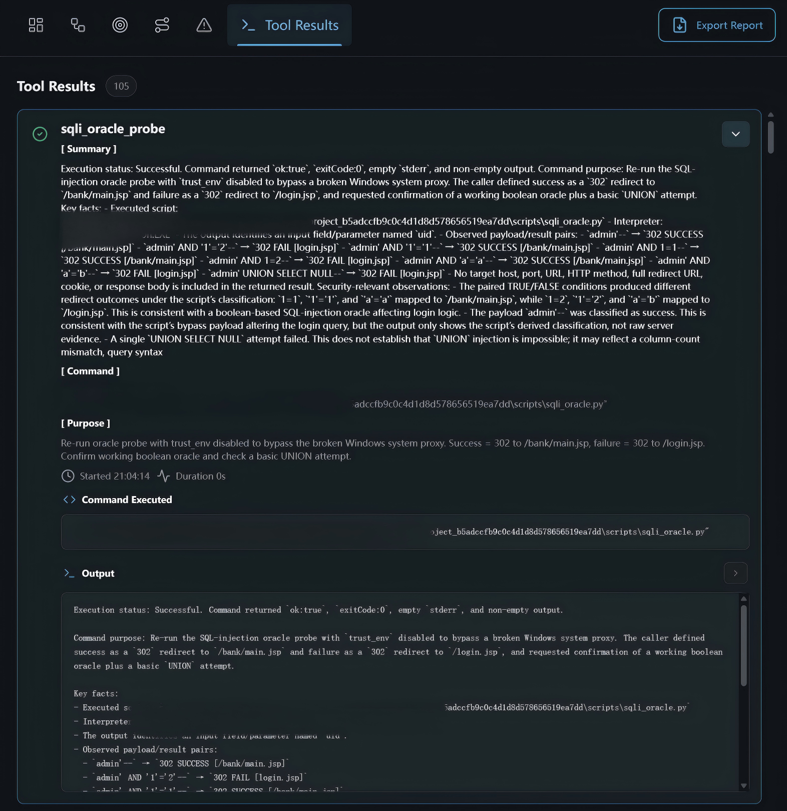

Use Tool Results to review records returned by tools called by agents:

- Review the tool name, execution status, and summary at the top of each result entry.
- Expand a result to view its **Summary**, **Command**, **Purpose**, start time, and duration.
- Review **Command Executed** and **Output** to see the executed command and its returned content.
- The total number of result entries appears at the top of the page. Results depend on the tools that ran and the data they returned.
- Click **Export Report** to export the project report.

### Asset Management

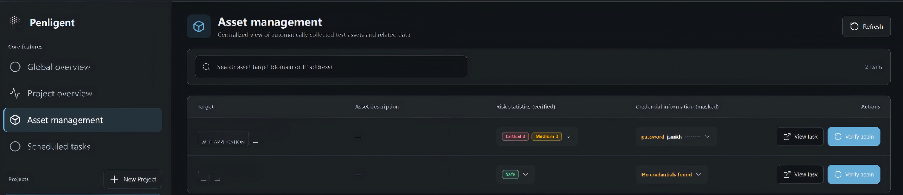

Asset Management provides a centralized view of discovered test assets and related data:

- Enter a domain or IP address in the search box to filter the assets.
- **Target** shows the asset target; **Asset description** shows its description, when available.
- **Risk statistics (verified)** shows the severity and count of verified risks.
- **Credential information (masked)** shows masked credential-related information. Sensitive values are obscured.
- Click **View task** to open the task associated with the asset.
- Click **Verify again** to create a verification task for the target. Confirm that you still have authorization before starting it.
- Click **Refresh** to reload the asset list.

### Scheduled Tasks

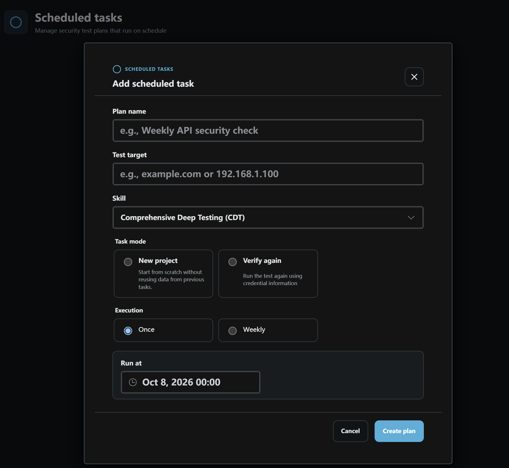

Create a scheduled test from **Scheduled tasks**:

1. Enter a **Plan name** and **Test target**, then select a testing plan under **Skill**.
2. Choose a **Task mode**:
   - **New project:** Start from scratch without reusing data from previous tasks.
   - **Verify again:** Run the test again using credential information.
3. Under **Execution**, choose **Once** or **Weekly**.
4. Set the run time based on the selected execution option. The screenshot shows **Run at** for the **Once** option.
5. Click **Create plan** to create the schedule, or **Cancel** to discard it.

### Export a Project Report

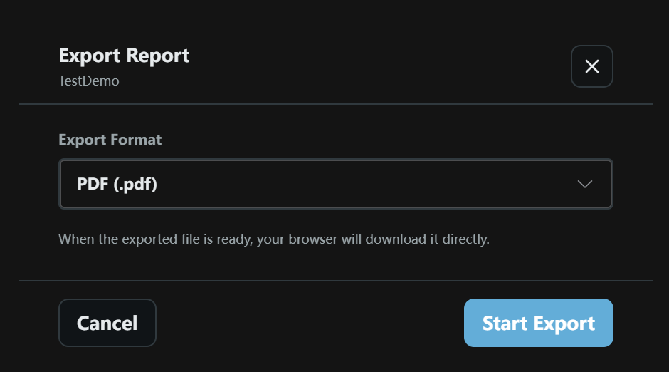

1. Click **Export Report** on the project page to open the report export dialog.
2. Select an available format under **Export Format**. The screenshot shows **PDF (.pdf)** for project reports.
3. Click **Start Export**. The browser downloads the file when it is ready.
4. Click **Cancel** to cancel the operation.

### Settings

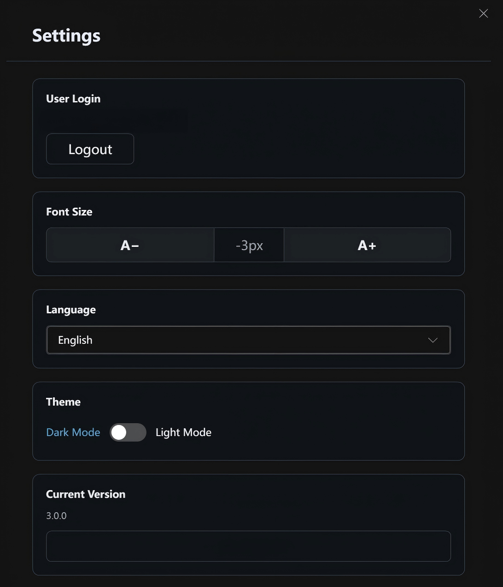

Use **Settings** to adjust application preferences and check version information:

- **User Login:** View the signed-in user and click **Logout** to sign out.
- **Font Size:** Click **A−** or **A+** to adjust the interface font size. The current adjustment is shown between the buttons.
- **Language:** Select the interface language from the drop-down menu.
- **Theme:** Switch between **Dark Mode** and **Light Mode**.
- **Current Version:** View the installed version and click **Check Update** to check for updates.
